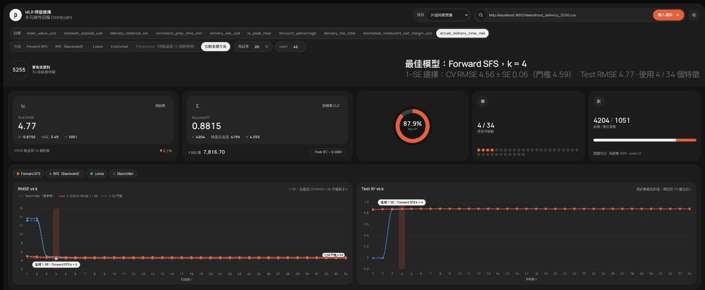
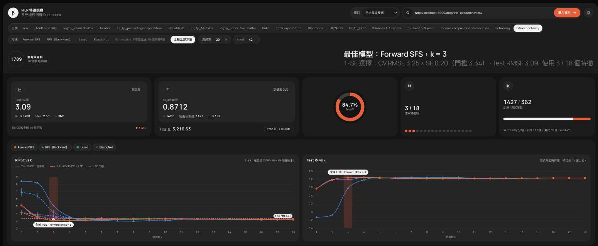
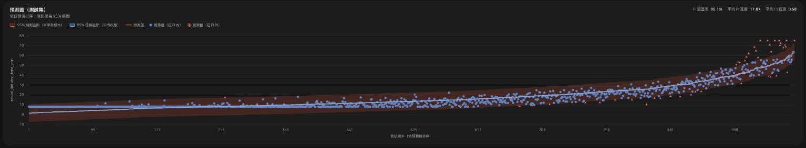
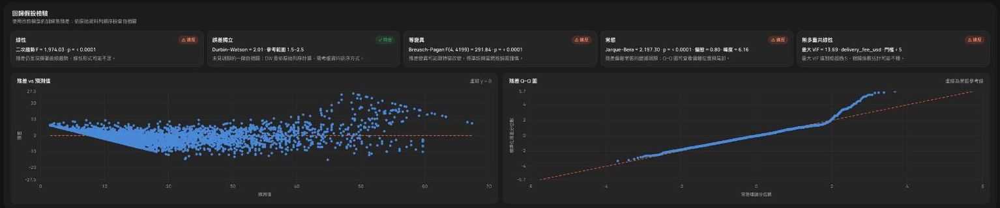
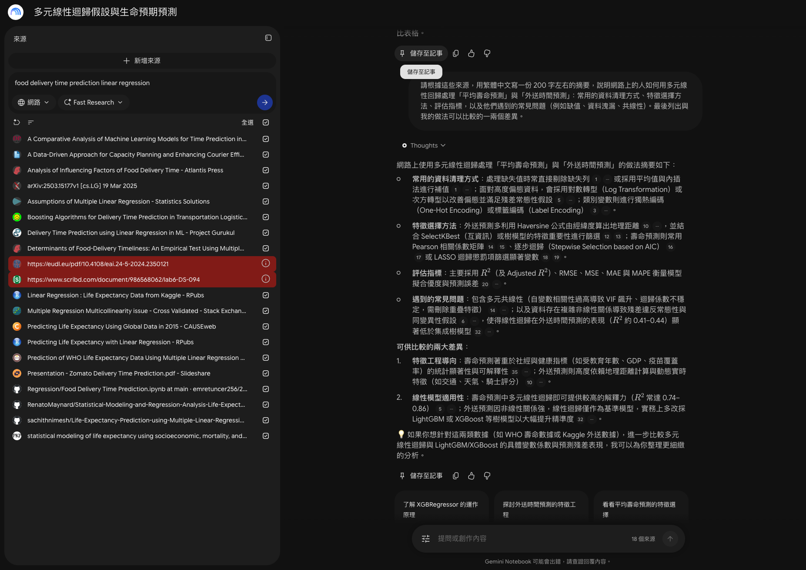

# AIoT-HW2-MultipleLR

**課程：** AIoT 與數據分析（AIoT-DA）

**作業：** HW2：Multiple Linear Regression

**GitHub 儲存庫：** [anjyuelee/AIoT-HW2-MultipleLR](https://github.com/anjyuelee/AIoT-HW2-MultipleLR)

**線上網頁：** [https://anjyuelee.github.io/AIoT-HW2-MultipleLR/](https://anjyuelee.github.io/AIoT-HW2-MultipleLR/)

本專題以兩個 Kaggle 資料集完成多元線性回歸分析，依 CRISP-DM 記錄流程，並以純前端互動網頁呈現模型比較、預測區間與診斷結果。

## 作業要求對照表

| 作業要求 | 實現位置 |
|---|---|
| 選 Kaggle 資料集，候選特徵 14–39 個並標示來源 | 兩題皆符合：外送時間 14 個候選欄位、平均壽命 18 個；資料來源與連結見「資料集」及網頁頁尾。 |
| 使用多元線性回歸 | `regression.js` 以 OLS 擬合；網頁提供係數、回歸式與統計摘要。 |
| 特徵選擇 | Forward SFS、RFE、Lasso、ElasticNet；Exhaustive 在展開後特徵超過 15 個時停用。 |
| 模型評估 | 網頁模型表與圖呈現 CV RMSE、測試 RMSE、R²、MAE；只以訓練集 CV 選模，測試集只作最後評估。 |
| 預測圖含信賴區間／預測區間 | 網頁「預測圖（測試集）」顯示實際值、預測值、95% CI 與 PI；即時預測器也顯示區間。 |
| CRISP-DM 六階段 | [docs/crisp-dm-notes.md](docs/crisp-dm-notes.md)；網頁頁尾另有六階段流程卡片。 |
| GPT 輔助內容 | README「AI 協助說明」；[Codex 對話紀錄 PDF](docs/ai-logs/codex-hw2-conversation.pdf)。 |
| NotebookLM 摘要 | README「AI 協助說明」列出 Fast Research 流程、18 個匯入來源、NotebookLM 原文摘要、與本專案比較及截圖。 |
| GitHub repo 與網頁 | 本儲存庫及 [GitHub Pages 網頁](https://anjyuelee.github.io/AIoT-HW2-MultipleLR/)。 |
| 加分：下拉選單切換兩題 | 網頁題目下拉選單含外送時間與平均壽命兩題。 |
| 加分：任意 CSV 網址 | 選「自訂 CSV 網址」後可輸入 CSV URL；來源伺服器需允許 CORS。 |

## 資料集

| 題目 | Kaggle 資料集 | 分析筆數 | 候選特徵數 | 預測目標 | 切分方式 |
|---|---|---:|---:|---|---|
| 外送時間預測 | [Global Food Delivery Restaurant Market 2026](https://www.kaggle.com/datasets/luthfimuthathohirin/global-food-delivery-restaurant-market-2026) | 5,255 | 14（one-hot 後 34 欄） | `actual_delivery_time_min`（分鐘） | 隨機 80:20，seed 42 |
| 平均壽命預測 | [Life Expectancy (WHO)](https://www.kaggle.com/datasets/kumarajarshi/life-expectancy-who) | 1,789 | 18 | `Life expectancy`（年） | `Country` 分組 80:20，seed 42；測試 30 國 |

壽命資料的 `Country` 僅作分組鍵，不納入特徵。外送資料含模板式敘述與衍生欄位，疑似合成或經生成式加工；平均壽命資料有缺值、可疑量尺及國家年度自相關等限制。詳見 CRISP-DM 工作筆記。

## 結果摘要

CV RMSE 為 5-fold 驗證的平均值；全域模型依 1-SE 法則選出。測試集指標只用於最終評估。

| 題目 | 最終模型與特徵 | CV RMSE | 測試指標 | 95% PI 涵蓋率 | 成功標準 |
|---|---|---:|---|---:|---|
| 外送時間 | Forward SFS，k = 4：`delivery_fee_usd`、`delivery_distance_km`、`is_peak_hour`、`weather_condition_Heavy Rain / Storm` | 4.5632 分鐘（最低值 4.5351，SE 0.0558） | RMSE 4.7698 分鐘；R² 0.8792；MAE 3.4898 分鐘 | 95.05%；平均 PI 寬 17.87 分鐘 | **達成**：RMSE ≤ 5、PI 93–97%；4 特徵模型相較全特徵 R² = 0.8789 未下降。 |
| 平均壽命 | Forward SFS，k = 3：`Income composition of resources`、`HIV/AIDS`、`Adult Mortality` | 3.2482 年（最低值 3.2415，SE 0.0971） | RMSE 3.0916 年；R² 0.8468；MAE 2.5022 年 | 95.58%；平均 PI 寬 12.54 年 | **達成**：MAE ≤ 3、PI 90–98%；3 特徵模型的 MAE 比全特徵模型增加 0.0336 年（門檻 0.5 年）。 |

涵蓋率是目前固定測試集上的比例，不代表所有配送距離、國家或未來期間都能達到相同涵蓋。外送題的區間在短程訂單偏寬、長程訂單偏窄；兩題均有部分回歸假設違反，需結合文件中的診斷限制解讀。

## 頁面截圖

**外送時間預測**



**平均壽命預測**



**測試集預測圖與區間**



**回歸假設檢驗**



## CRISP-DM 六階段摘要

1. **商業理解**：界定兩題的預測問題、使用者、限制與事前設定的業務成功標準。
2. **資料理解**：檢視資料來源、欄位、缺值、分布、異常、共線性及目標關係。
3. **資料準備**：排除洩漏欄位、清理及轉換特徵；外送題只保留 app 訂單，壽命題採完整案例並保留 `Country` 分組鍵。
4. **建模**：在訓練集內執行 5-fold CV，每個 fold 重跑特徵選擇與 OLS；壽命題使用分組 fold。
5. **評估**：以 1-SE 法則選較精簡模型，在測試集評估 RMSE、R²、MAE、PI 涵蓋率及回歸假設。
6. **部署**：純前端靜態網頁可部署在 GitHub Pages，提供兩題切換、自訂 CSV、圖表與即時預測器。

完整決策、欄位處理、模型表格、成功標準逐項評估及假設檢驗見 [docs/crisp-dm-notes.md](docs/crisp-dm-notes.md)。

## 主要方法

- **5-fold CV**：只在外層訓練資料中評估候選方法與 k；每個 fold 內重新做特徵選擇與 OLS。依 `Country` 分組時，同國家不跨 fold。
- **1-SE 法則**：以最低 CV RMSE + 該點標準誤作門檻，於門檻內選特徵數較少的模型；k 相同時選 CV RMSE 較低者。外層測試集不參與選模。
- **切分**：外送訂單隨機切分；壽命題依國家分組切分，以檢查對未見國家的泛化，不代表未來年份預測。
- **95% CI／PI**：利用 OLS QR 分解計算平均反應信賴區間與單筆新樣本預測區間；不直接反轉 `XᵀX`。
- **五大假設檢驗**：線性（殘差對預測值及二次趨勢檢查）、Durbin–Watson、Breusch–Pagan、Jarque–Bera、VIF。

## 本機執行

在專案根目錄啟動靜態伺服器：

```bash
python3 -m http.server 8765
```

開啟 <http://127.0.0.1:8765/>。重新整理處理資料時可執行：

```bash
python3 data/prepare_food_delivery.py
python3 data/prepare_life_expectancy.py
```

原始 CSV 放在 `data/raw/`，已由 `.gitignore` 排除。自訂 CSV 網址需可由瀏覽器存取，並允許跨來源讀取（CORS）。

## 專案結構

```text
.
├── config.js                      # 題目 preset、資料來源與成功標準
├── index.html                     # 網頁結構與題目選單
├── app.js                         # 載入、切分、建模結果與互動介面
├── regression.js                  # CSV、OLS、CV、特徵選擇、區間與診斷
├── style.css                      # 淺色／深色主題及版面樣式
├── data/
│   ├── prepare_food_delivery.py   # 外送資料準備
│   ├── prepare_life_expectancy.py # 壽命資料準備
│   ├── food_delivery_2026.csv     # 處理後外送資料
│   └── life_expectancy.csv        # 處理後壽命資料
├── docs/
│   ├── crisp-dm-notes.md          # CRISP-DM 詳細工作筆記
│   └── ai-logs/                   # GPT 對話紀錄 PDF 存放處
└── screenshots/                  # README 使用的題目、預測圖與診斷截圖
```

## AI 協助說明

### GPT 輔助內容

ChatGPT 協助資料理解與欄位意義整理、資料洩漏及共線性判斷、特徵準備策略、CRISP-DM 文件撰寫、前端模型流程與區間／診斷功能實作，以及 CV、1-SE 選模和結果摘要。程式與數字以專案資料及 Node／瀏覽器計算核對；資料來源未提供的資訊以限制或假設標示，不把 AI 推論當成來源證據。

本作業匯出的 GPT 對話紀錄 PDF 請放在 [`docs/ai-logs/`](docs/ai-logs/)；目前資料夾保留為提交位置。

### NotebookLM 摘要

#### 使用方式

在 NotebookLM 使用 Fast Research，分別搜尋「Life expectancy WHO dataset multiple linear regression」與「food delivery time prediction linear regression」，匯入 18 個網路來源；另有 2 個來源匯入失敗。接著請 NotebookLM 綜合來源摘要網路上常見的多元線性迴歸資料準備、特徵選擇、評估及假設診斷做法。



#### 匯入來源

以下標題依 NotebookLM 顯示，部分標題在介面中被截斷：

**外送時間**

1. A Comparative Analysis of Machine Learning Models for Time Prediction in…
2. A Data-Driven Approach for Capacity Planning and Enhancing Courier Effi…
3. Analysis of Influencing Factors of Food Delivery Time - Atlantis Press
4. arXiv:2503.15177v1 [cs.LG] 19 Mar 2025
5. Boosting Algorithms for Delivery Time Prediction in Transportation Logistic…
6. Delivery Time Prediction using Linear Regression in ML - Project Gurukul
7. Determinants of Food-Delivery Timeliness: An Empirical Test Using Multipl…
8. Presentation - Zomato Delivery Time Prediction.pdf - Slideshare
9. Regression/Food Delivery Time Prediction.ipynb at main · emretuncer256/2…

**平均壽命**

1. Linear Regression : Life Expectancy Data from Kaggle - RPubs
2. Predicting Life Expectancy Using Global Data in 2015 - CAUSEweb
3. Predicting Life Expectancy with Linear Regression - RPubs
4. Prediction of WHO Life Expectancy Data Using Multiple Linear Regression…
5. RenatoMaynard/Statistical-Modeling-and-Regression-Analysis-Life-Expect…
6. sachithnimesh/Life-Expectancy-Prediction-using-Multiple-Linear-Regressi…
7. statistical modeling of life expectancy using socioeconomic, mortality, and…

**通用回歸方法**

1. Assumptions of Multiple Linear Regression - Statistics Solutions
2. Multiple Regression Multicollinearity issue - Cross Validated - Stack Exchange

#### NotebookLM 產生的摘要（原文）

> 網路上使用多元線性迴歸處理「平均壽命預測」與「外送時間預測」的做法摘要如下：
>
> - 常用的資料清理方式：處理缺失值時常直接剔除缺失列或採用平均值與內插法進行補值；面對高度偏態資料，會採用對數轉型（Log Transformation）或次方轉型以改善偏態並滿足殘差常態性假設；類別變數則進行獨熱編碼（One-Hot Encoding）或標籤編碼（Label Encoding）。
> - 特徵選擇方法：外送預測多利用 Haversine 公式由經緯度算出地理距離，並結合 SelectKBest（互資訊）或樹模型的特徵重要性進行篩選；壽命預測則常用 Pearson 相關係數矩陣、逐步迴歸（Stepwise Selection based on AIC）或 LASSO 迴歸懲罰項篩選顯著變數。
> - 評估指標：主要採用 R²（及 Adjusted R²）、RMSE、MSE、MAE 與 MAPE 衡量模型擬合優度與預測誤差。
> - 遇到的常見問題：包含多元共線性（自變數相關性過高導致 VIF 飆升、迴歸係數不穩定，需刪除重疊特徵）；以及資料存在複雜非線性關係導致殘差違反常態性與同變異性假設，使得線性迴歸在外送時間預測的表現（R² 約 0.41–0.44）顯著低於集成樹模型。
>
> 可供比較的兩大差異：
>
> 1. 特徵工程導向：壽命預測著重於社經與健康指標（如受教育年數、GDP、疫苗覆蓋率）的統計顯著性與可解釋性；外送預測則高度依賴地理距離計算與動態實時特徵（如交通、天氣、騎士評分）。
> 2. 線性模型適用性：壽命預測中多元線性迴歸即可提供較高的解釋力（R² 常達 0.74–0.86）；外送預測因非線性關係強，線性迴歸僅作為基準模型，實務上多改採 LightGBM 或 XGBoost 等樹模型以大幅提升精準度。

#### 與本專案做法的比較

| 面向 | NotebookLM 摘要中的常見做法 | 本專案做法 |
|---|---|---|
| 缺值處理 | 刪除缺值列，也常以平均值或內插補值；偏態欄位可做 log／次方轉換。 | 外送資料僅保留 app 訂單；壽命題先把兩個疑似缺值代碼 0 轉為缺值，再對目標和所有候選特徵採完整案例，不在切分前用全資料補值，以免測試集資訊進入前處理。偏態非負欄位採 log1p。 |
| 特徵選擇 | 外送可用 Haversine 距離、SelectKBest 或樹模型重要度；壽命可用相關係數、AIC 逐步迴歸或 LASSO。 | 比較 Forward SFS、RFE、Lasso、ElasticNet；在訓練集內做 5-fold CV，每個 fold 重跑選擇與 OLS，以 1-SE 法則選擇較精簡模型，不以測試集挑 k。 |
| 資料切分 | 摘要所整理來源未提供可統一核實的切分策略。 | 外送題隨機 80:20；壽命題依 Country 分組 80:20，同一國家不跨訓練／測試或 CV fold，以測試未見國家的表現。 |
| 共線性處理 | 以 VIF 找出高度共線欄位，刪除重疊特徵以穩定係數。 | 計算 VIF 並在訓練集選特徵。外送題不保留精確線性可算出的淨有效價格；入選模型的最大 VIF 為 13.69。壽命題最終模型最大 VIF 為 1.82。 |
| 外送題 R² | NotebookLM 彙整來源中的線性模型約 0.41–0.44。 | 測試 R² = 0.8792，明顯高於摘要引用的網路結果。此差距支持外送資料可能是近似線性生成的合成資料之判斷，但資料集、欄位與切分不同，不能視為嚴格同條件比較。 |
| 平均壽命題 R² | NotebookLM 彙整來源常見約 0.74–0.86。 | 依 Country 分組、測試國家完全未見的測試 R² = 0.8468，落在摘要範圍內。 |

NotebookLM 摘要中的方法與 R² 數字是依其整理的網路來源彙總，未逐一開啟及查證原始研究、資料集、切分方式或計算細節；不同來源的結果不一定能直接比較。本表將這些內容作為背景參考，不作為可重現的基準實驗。
